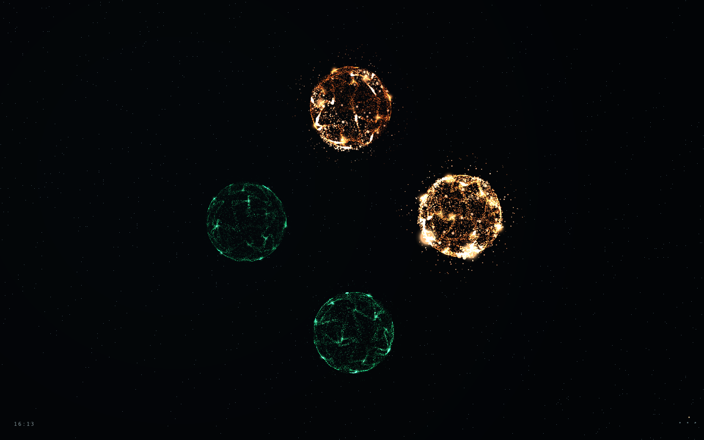

# Agent Orbs

[English](README.md)

Un observatorio local de tus sesiones de [Claude Code](https://claude.com/claude-code) y [Codex](https://github.com/openai/codex) en terminal. Cada terminal abierta se convierte en un orbe de partículas: naranja para Claude y verde para Codex. En reposo, los orbes respiran. Mientras el agente trabaja, se activan como neuronas, y se iluminan cuando entrega su respuesta final. Así ves de un vistazo qué sesión te necesita.



Todo funciona en tu equipo. No hay cuentas, nube ni telemetría, y el servidor solo escucha en `127.0.0.1`.

## Requisitos

- **Linux.** Las sesiones se detectan a través de `/proc`, por lo que no funciona en macOS ni en Windows.
- **Node.js 22.12 o superior**, y npm.
- Claude Code y/o Codex abiertos en una terminal.
- Opcional: `sqlite3`, para leer los títulos que genera Codex.
- Un navegador con WebGL2. Sin él, la app muestra una vista simplificada.

## Instalación

```sh
git clone https://github.com/Jeanback1/agent-orbs.git
cd agent-orbs
npm ci
npm run build
npm run install:hooks   # recomendado, ver más abajo
npm start
```

Después abre **http://127.0.0.1:3210**.

Para usar otro puerto: `PORT=3211 npm start`.

### Hooks

`npm run install:hooks` añade un pequeño hook de solo observación a `~/.claude/settings.json` y `~/.codex/hooks.json`. Con él, los cambios de estado se ven al instante. Sin él, la app sigue funcionando a partir de los registros de las sesiones.

- Solo se añaden las entradas del propio hook. El resto de tu configuración y tus otros hooks se conservan, y los archivos anteriores se copian a `~/.agent-orbs/backups/`.
- Codex puede pedirte revisar los hooks nuevos en `/hooks`.
- Las terminales que ya estaban abiertas pueden necesitar reiniciarse para empezar a enviar eventos.
- Los comandos del hook apuntan a esta carpeta. Si mueves el clon, vuelve a ejecutar `npm run install:hooks`.

### Ejecutar en segundo plano (opcional)

```sh
npm run install:service             # crea ~/.config/systemd/user/agent-orbs.service
systemctl --user start agent-orbs
systemctl --user enable agent-orbs  # solo si quieres que arranque con tu sesión
```

Para otro puerto: `PORT=3211 npm run install:service`.

## Uso

- Haz clic en un orbe para ver el título y la carpeta de su sesión.
- El botón **···** abre el panel, que incluye:
  - la lista de sesiones;
  - zoom y reducción de movimiento;
  - sonido al terminar;
  - FPS;
  - un **modo demo** que simula de 0 a 40 sesiones sin tocar las reales.
- Estados:
  - **Trabajando**: hay herramientas en ejecución o un prompt en proceso.
  - **Respuesta final**: el agente acaba de responder. El orbe se ilumina unos 2 segundos.
  - **En espera**: inactivo, esperándote.
  - **Te necesita**: hay un permiso o una pregunta pendiente.
  - **Detectada**: se encontró el proceso, pero todavía no se pudo identificar su sesión.
- Los subagentes lanzados desde una terminal aparecen como lunas pequeñas junto a su orbe principal.

Los títulos salen de lo que guarda cada herramienta: un nombre puesto con `/rename` en Claude Code, el título que genera Claude Code o el nombre del hilo de Codex. Si no hay ninguno, se usa el nombre de la carpeta del proyecto.

## Privacidad y seguridad

- Los hooks envían solo el ID de sesión, el tipo de evento, el nombre de la herramienta, el tipo de notificación o el motivo de cierre, y el ID del proceso de la terminal. **Nunca envían prompts, argumentos de herramientas ni respuestas.**
- El servidor lee pequeños fragmentos de los registros locales para obtener títulos y estados. Ese contenido no se envía al navegador.
- El servidor escucha solo en `127.0.0.1` y rechaza peticiones con un encabezado `Host` u `Origin` ajeno. Los eventos de los hooks requieren un token aleatorio que se crea en cada arranque. Ese token se guarda en `~/.agent-orbs/server.json` con permisos `0600`.
- Cualquier programa de tu equipo puede leer `/api/sessions`, que incluye títulos, carpetas y estados. Tenlo en cuenta si compartes el equipo con otros usuarios.
- No se guarda historial de conversaciones. El tiempo de cada orbe cuenta desde que el servicio lo detectó.

## Desinstalar

```sh
npm run remove:hooks
npm run remove:service   # si lo instalaste
```

Después borra la carpeta y `~/.agent-orbs/`.

## Limitaciones

- La app cubre sesiones interactivas de terminal en este equipo. No sigue las apps de escritorio, las sesiones remotas ni las ejecuciones no interactivas (`claude -p`, `codex exec`).
- Las versiones recientes de Codex ejecutan los hilos dentro de un daemon compartido. Si varias terminales de Codex arrancan a la vez en la misma carpeta, la app no puede saber qué hilo corresponde a cada una. En ese caso quedan como **Detectada** en lugar de adivinar. Ejecutar `codex --no-daemon` lo evita.
- Los formatos de sesión de Claude Code y Codex no son APIs públicas. Una versión nueva de cualquiera de las dos herramientas puede cambiarlos.

## Desarrollo

```sh
npm test               # pruebas unitarias y de integración
npm run build          # comprobación de tipos y build de producción
npm run dev            # servidor de Vite; necesita el backend en el puerto 3210
```

Comprobaciones en el navegador. Necesitan el servicio en marcha y Chromium; usa `CHROMIUM_PATH` si no está en `/usr/bin/chromium`:

```sh
node scripts/browser-check.mjs
node scripts/animation-check.mjs
node scripts/benchmark.mjs test-results/particle-performance.json
```

El renderizado usa WebGL2. Las partículas y conexiones se animan en la GPU, la densidad se adapta al tamaño del orbe y la animación se pausa cuando la pestaña no está visible.

## Licencia

[MIT](LICENSE). Agent Orbs adapta parte de [Pixel Agents](https://github.com/pixel-agents-hq/pixel-agents); ver [ATTRIBUTION.md](ATTRIBUTION.md).
