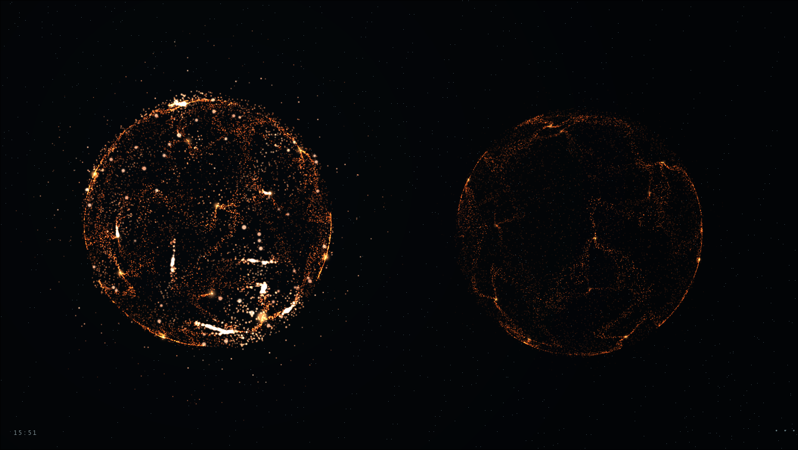
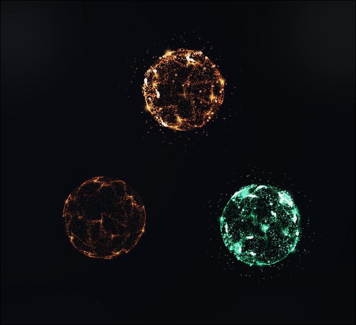

# Agent Orbs

[Español](README.es.md)

A local observatory for your [Claude Code](https://claude.com/claude-code) and [Codex](https://github.com/openai/codex) terminal sessions. Each open terminal becomes a glowing orb of particles: orange for Claude, green for Codex. Orbs breathe while idle, fire like neurons while the agent works and flare when it delivers its final answer, so you can see at a glance which session needs you.


Everything runs on your machine. There are no accounts, no cloud and no telemetry. The server only listens on `127.0.0.1`.

## Screenshots

Two Claude Code sessions up close. The left one is working and its neurons fire; the right one is waiting for you.



Claude and Codex side by side: one Claude session working, another waiting, and a Codex session working.



## Requirements

- **Linux.** Sessions are discovered through `/proc`, so macOS and Windows are not supported.
- **Node.js 22.12 or newer**, and npm.
- Claude Code and/or Codex running in a terminal.
- Optional: `sqlite3`, to read Codex's generated thread titles.
- A browser with WebGL2. Without it, the app falls back to a simpler view.

## Install

```sh
git clone https://github.com/Jeanback1/agent-orbs.git
cd agent-orbs
npm ci
npm run build
npm run install:hooks   # recommended, see below
npm start
```

Then open **http://127.0.0.1:3210**.

To use another port: `PORT=3211 npm start`.

### Hooks

`npm run install:hooks` adds a small observation-only hook to `~/.claude/settings.json` and `~/.codex/hooks.json`. With it, status changes show up instantly. Without it, the app still works by reading the session logs.

- Only the hook's own entries are added. Your other settings and hooks are preserved, and the previous files are backed up to `~/.agent-orbs/backups/`.
- Codex may ask you to review the new hooks in `/hooks`.
- Terminals that were already open may need a restart to start sending hook events.
- The hook commands point to this folder. If you move the clone, run `npm run install:hooks` again.

### Run in the background (optional)

```sh
npm run install:service             # writes ~/.config/systemd/user/agent-orbs.service
systemctl --user start agent-orbs
systemctl --user enable agent-orbs  # only if you want it to start with your session
```

For a different port: `PORT=3211 npm run install:service`.

## Usage

The interface is in Spanish. The labels below are given in English.

- Click an orb to see its session title and folder.
- The **···** button opens the panel: session list, zoom, reduced motion, finish chime, FPS and a **demo mode** that simulates 0–40 sessions without touching your real ones.
- States:
  - **Working**: tools running or a prompt being processed.
  - **Final answer**: the agent just replied. The orb flares for about 2 seconds.
  - **Waiting**: idle, waiting for you.
  - **Needs you**: a permission prompt or question is waiting.
  - **Detected**: a process was found, but its session could not be identified yet.
- Subagents launched from a terminal appear as smaller moons next to their parent orb.

Titles come from what each tool stores: a name set with `/rename` in Claude Code, the title Claude Code generates, or Codex's thread name. If there is none, the project folder name is used.

## Privacy and security

- The hooks send only the session ID, the event type, the tool name, the notification type or session-end reason, and the terminal's process ID. **Prompts, tool arguments and responses are never sent.**
- The server reads small fragments of the local session logs to get titles and status. Their content is not passed to the browser.
- The server listens only on `127.0.0.1`. It rejects requests with a foreign `Host` or `Origin` header, and hook events require a random token created at each start. That token is stored in `~/.agent-orbs/server.json` with `0600` permissions.
- `/api/sessions` (titles, folders and status) is readable by any program on your machine. On a computer shared with other users, keep that in mind.
- Conversation history is not saved. The time shown for each orb counts from when the service first saw it.

## Uninstall

```sh
npm run remove:hooks
npm run remove:service   # if you installed it
```

Then delete the folder and `~/.agent-orbs/`.

## Limitations

- This app covers interactive terminal sessions on this computer. The desktop apps, remote sessions and non-interactive runs (`claude -p`, `codex exec`) are not tracked.
- Recent Codex versions run threads inside a shared daemon. When several Codex terminals start in the same folder at the same moment, the app cannot tell which thread belongs to which terminal. Those terminals stay as **Detected** rather than guessing. Running `codex --no-daemon` avoids this.
- The session formats of Claude Code and Codex are not public APIs. A new version of either tool may change them.

## Development

```sh
npm test               # unit and integration tests
npm run build          # type check and production build
npm run dev            # Vite dev server; needs the backend running on port 3210
```

Browser checks (need the service running and Chromium; set `CHROMIUM_PATH` if it is not at `/usr/bin/chromium`):

```sh
node scripts/browser-check.mjs
node scripts/animation-check.mjs
node scripts/benchmark.mjs test-results/particle-performance.json
```

Rendering is WebGL2. Particles and connections are animated on the GPU, density adapts to orb size and animation pauses when the tab is hidden.

## License

[MIT](LICENSE). Agent Orbs adapts part of [Pixel Agents](https://github.com/pixel-agents-hq/pixel-agents); see [ATTRIBUTION.md](ATTRIBUTION.md).
